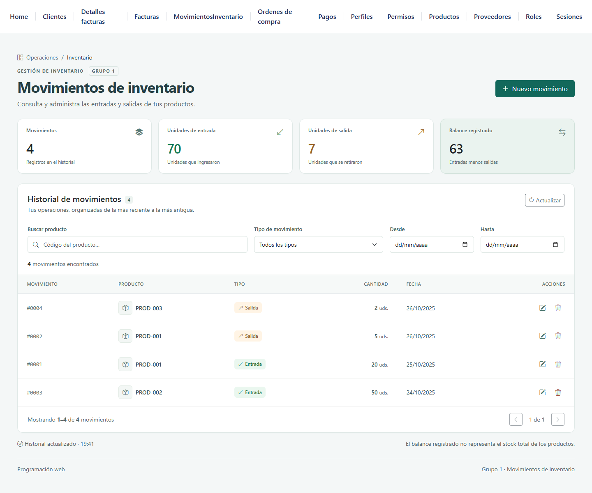

# Movimientos de inventario del Grupo 1

Módulo de programación web para registrar y consultar entradas y salidas de productos. Implementado con Angular 20, TypeScript y Bootstrap sobre la API Spring Boot del proyecto de clase.



## Funciones

- Consultar, crear, editar y eliminar movimientos mediante la API REST.
- Validar código, tipo, cantidad entera positiva y fecha de calendario.
- Buscar por código y combinar filtros de tipo y fechas.
- Ordenar por fecha reciente y paginar el historial.
- Mostrar entradas, salidas y balance de los registros completos.
- Confirmar la eliminación y conservar el formulario ante errores de red.
- Usar la interfaz en escritorio y móvil, con navegación por teclado e iconos accesibles.

## Aporte del Grupo 1

El trabajo asignado corresponde a **Movimientos de inventario**. Los cuatro archivos de entrega están en:

```text
proyectoFinal/web/proyecto-app-front/src/app/
├── componentes/inventario-movimiento-component/
│   ├── inventario-movimiento-component.ts
│   ├── inventario-movimiento-component.html
│   └── inventario-movimiento-component.css
└── services/
    └── inventario-movimiento-service.ts
```

El componente coordina el estado, el formulario y los eventos; el servicio concentra GET, POST, PUT y DELETE. La plantilla y los estilos aprovechan la configuración de Bootstrap e iconos suministrada por el profesor.

Este repositorio es un fork de [alejandroria94/proyectoClase](https://github.com/alejandroria94/proyectoClase). El backend Java, el modelo y los otros módulos pertenecen a esa base de clase. Se usó el módulo de clientes como referencia. La asistencia de IA se empleó de acuerdo con la autorización del curso; la documentación explica el código para su sustentación.

## Tecnologías

| Capa | Herramientas |
| --- | --- |
| Interfaz | Angular 20, TypeScript, formularios reactivos y signals |
| Presentación | Bootstrap 5.3 y Bootstrap Icons |
| Comunicación | HttpClient y RxJS |
| API suministrada | Java 17, Spring Boot 3.3 y Spring Data JPA |
| Datos de demostración | H2 en memoria y `data.sql` |

## Ejecutar el proyecto

Se necesita Java 17, Node compatible con Angular 20 y npm. Se verificó con Node 22. IntelliJ sirve para ejecutar el backend y VS Code para trabajar con Angular.

```bash
git clone https://github.com/RobertCaicedo3723/proyectoClase.git
cd proyectoClase
```

### Backend

Abrir `proyectoFinal/pom.xml` en IntelliJ como proyecto Maven, configurar Java 17 y ejecutar el método `main` de `ProyectoApplication.java`.

También se puede iniciar con Maven Wrapper. En Windows:

```powershell
cd proyectoFinal
.\mvnw.cmd -Dmaven.test.skip=true spring-boot:run
```

En macOS o Linux:

```bash
cd proyectoFinal
sh ./mvnw -Dmaven.test.skip=true spring-boot:run
```

El POM suministrado no declara las dependencias de la prueba JUnit de ejemplo. El parámetro anterior permite arrancar sin compilar esa prueba y no equivale a ejecutar pruebas Java. El código fuente del backend se conserva.

### Frontend

En otra terminal:

```bash
cd proyectoFinal/web/proyecto-app-front
npm ci
npm start
```

Abrir [Movimientos de inventario](http://localhost:4200/movimientosInventario). La API se encuentra en [inventario-movimientos](http://localhost:8080/api/inventario-movimientos) y su documentación en [Swagger](http://localhost:8080/swagger-ui.html).

La configuración CORS del backend permite `http://localhost:4200`. Usar ese origen al ejecutar la demostración.

## Documentación y entrega

- [Informe técnico de 10 páginas](entrega-grupo1/Informe_Grupo1.pdf).
- [Guía de sustentación y preguntas](entrega-grupo1/Guia_de_sustentacion.md).
- [Los cuatro archivos explicados línea por línea](entrega-grupo1/Codigo_explicado.html). Descargar el HTML y abrirlo en un navegador para usar la búsqueda y los filtros.
- [11 capturas de funcionamiento](entrega-grupo1/capturas/).
- [ZIP con exactamente los cuatro archivos solicitados](entrega-grupo1/Grupo1_MovimientosInventario.zip).
- [Paquete completo de documentación y entrega](entrega-grupo1/Grupo1_Entrega_Completa.zip).
- [Resultados y versión del código verificado](entrega-grupo1/evidencias/).

## Verificación

Se aprobaron **26 comprobaciones de integración**: CRUD con API real, filtros, límites de validación, persistencia al recargar el navegador, errores controlados, paginación, teclado y móvil. Se verificó que los registros originales permanecieran intactos. Los fallos de conexión se simularon únicamente en el navegador de pruebas.

La revisión automática con axe-core no encontró infracciones en las tres vistas comprobadas: escritorio, formulario y móvil.

```bash
cd proyectoFinal/web/proyecto-app-front
npm run build
```

La compilación de producción finaliza correctamente. La base con Bootstrap conserva un aviso de carga inicial de aproximadamente 655 kB frente al umbral de advertencia de 500 kB; se mantiene por debajo del límite de error de 1 MB. No se ampliaron los presupuestos para ocultarlo.

## Alcance del inventario

La API suministrada guarda movimientos y no actualiza automáticamente el `stock` de productos. `productoCodigo` es un texto, sin una relación de clave foránea con el catálogo. El balance mostrado suma entradas y resta salidas del historial; puede ser negativo y no representa disponibilidad de stock.

Las reglas implementadas validan el formulario del frontend. Las llamadas directas a la API pueden omitirlas porque el backend de clase se conserva sin cambios.

H2 está en memoria: recargar el navegador conserva los datos mientras Spring Boot sigue activo; reiniciar el backend vuelve a cargar los ejemplos de `data.sql`.
